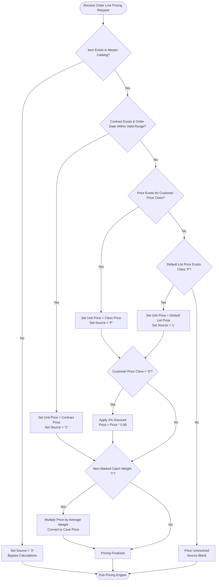
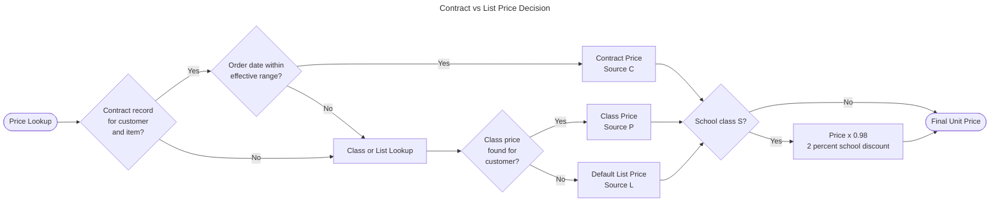
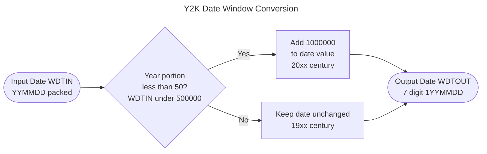
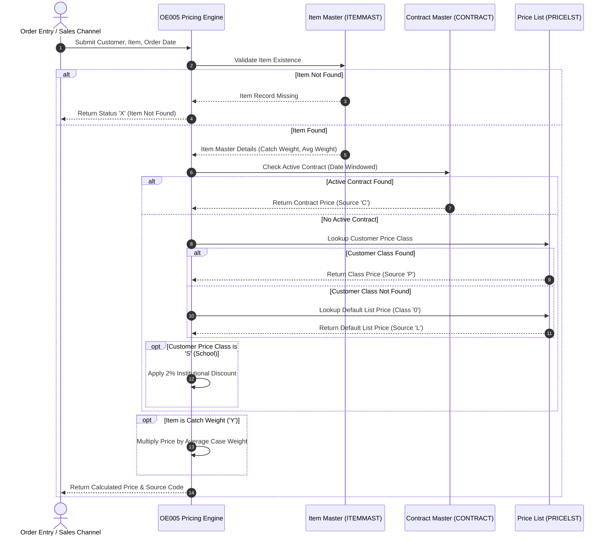
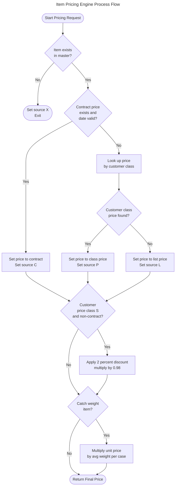

total 96
drwxr-xr-x    2 lab01    0              8192 Oct  8 23:38 .
drwxr-xr-x    3 lab01    0              8192 Oct  8 23:38 ..
-rw-r--r--    1 lab01    0             22727 Oct  8 23:38 OE005-business-rules.md
# 1. Executive Summary

The Order Entry Item Pricing Engine (`OE005`) serves as the core pricing determination service within the sales order processing lifecycle. Its primary business purpose is to accurately calculate the net unit and case selling price for products requested on sales orders, ensuring consistent enforcement of customer-specific agreements, standard catalog pricing, promotional allowances, and product packaging specifications.

The pricing engine executes a multi-tiered hierarchy to establish the base price, starting with customer contract verification and falling back to customer tier pricing or standard list prices. Once a base price is established, the system evaluates secondary business policies, including special institutional discounts for educational entities and case-level pricing conversions for variable-weight (catch weight) merchandise. Additionally, the engine incorporates standardized date-handling logic to guarantee accurate date-range comparisons across century boundaries.

By centralizing pricing calculations, the program prevents manual billing errors, guarantees contract compliance, protects profit margins, and ensures that customers receive their entitled discounts automatically during order entry.

---

# 2. Detailed Business Rules

### Item Catalog Verification
**Category:** Validation  
**Domain:** Inventory  

**Description:** Verifies that a valid item record exists in the master catalog prior to initiating any pricing calculations. If the item is unrecognized, pricing is immediately aborted.

**Trigger Conditions:**
- A sales order line item is submitted for pricing evaluation.
- The item number does not exist within the active master product repository.

**Business Outcome:**
- The price source status is marked as item not found (`X`).
- All subsequent pricing lookups and adjustment calculations are bypassed.

**Related Data:** `ITEMMAST.WITEM`, `OE005.WSRC`

---

### Active Contract Price Determination
**Category:** Calculation  
**Domain:** Order  

**Description:** Evaluates whether a negotiated customer contract exists for the specific product and confirms that the current order date falls within the contractual effective and expiration date range.

**Trigger Conditions:**
- The item has been validated in the product catalog.
- A negotiated contract record exists matching both the customer account and item number.
- The sales order date is on or after the contract effective date and on or before the contract expiration date.

**Business Outcome:**
- The unit selling price is set directly to the negotiated contract price.
- The price source status is flagged as Contract Pricing (`C`).

**Related Data:** `CONTRACT.CCUST`, `CONTRACT.CITEM`, `CONTRACT.CEFFDT`, `CONTRACT.CEXPDT`, `CONTRACT.CPRICE`, `OE005.WDATE`, `OE005.WPRICE`, `OE005.WSRC`

---

### Customer Class and Default List Price Lookup
**Category:** Calculation  
**Domain:** Order  

**Description:** When no active contract price applies, the system attempts to price the item using the customer's assigned price classification. If no customer-class price exists, the system automatically falls back to the universal base list price.

**Trigger Conditions:**
- No active, date-valid contract pricing record exists for the customer and item combination.
- The pricing master contains a price assigned to the customer's account classification, or a standard default class (`0`) entry.

**Business Outcome:**
- If a record matching the customer's price class is found, the unit price is set to the class price and flagged with source (`P`).
- If no class-specific price exists, the unit price defaults to the standard list price and is flagged with source (`L`).

**Related Data:** `CUSTMAST.PCLASS`, `PRICELST.WITEM`, `PRICELST.PCLASS`, `PRICELST.LPRICE`, `OE005.WPRICE`, `OE005.WSRC`

---

### Educational Institution Price Adjustment
**Category:** Calculation  
**Domain:** Order  

**Description:** Applies an automated promotional discount to school accounts when purchasing items under standard price class or base list pricing schedules.

**Trigger Conditions:**
- The customer account is classified as an educational institution (Price Class `S`).
- The item was priced via standard price class (`P`) or default list price (`L`), rather than a negotiated contract (`C`).

**Business Outcome:**
- A 2% discount is applied to the unit base price (calculated as 98% of the price, rounded half-up).

**Related Data:** `CUSTMAST.PCLASS`, `OE005.WPRICE`, `OE005.WSRC`

---

### Catch Weight Case Conversion
**Category:** Calculation  
**Domain:** Order  

**Description:** Adjusts pricing for variable-weight products sold by the case by converting the per-pound rate into an estimated per-case price based on standard packaging weight averages.

**Trigger Conditions:**
- The product is identified in the inventory master as a catch weight item.
- A valid base unit price has been established.

**Business Outcome:**
- The unit price is converted to a case price by multiplying the per-pound price by the product's average case weight, rounded to standard currency precision.

**Related Data:** `ITEMMAST.CWFLAG`, `ITEMMAST.AVGWGT`, `OE005.WPRICE`, `OE005.WSRC`

---

### Century Windowing Date Normalization
**Category:** Calculation  
**Domain:** General  

**Description:** Normalizes 2-digit legacy year formats into chronological sequence keys to ensure historical and future contract validity dates are compared accurately across century boundaries.

**Trigger Conditions:**
- A legacy two-digit year date value requires chronological comparison or sorting.

**Business Outcome:**
- Date values with a two-digit year between 00 and 49 are interpreted as falling within the 2000–2049 century window and prefixed for chronological sorting.
- Date values with a two-digit year between 50 and 99 are interpreted as falling within the 1950–1999 century window.

**Related Data:** `WDTIN`, `WDTOUT`

---

### Business Rules Summary Table

| Rule Name | Category | Trigger | Outcome | Related Data |
|:---|:---|:---|:---|:---|
| **Item Catalog Verification** | Validation | Item not present in catalog | Set source to `X`, stop processing | `ITEMMAST.WITEM`, `OE005.WSRC` |
| **Contract Price Determination** | Calculation | Active contract within valid date range | Apply contract rate, set source to `C` | `CONTRACT.CPRICE`, `OE005.WPRICE`, `OE005.WSRC` |
| **Tier / List Price Determination** | Calculation | No contract; class or default price exists | Apply class rate (`P`) or list rate (`L`) | `PRICELST.LPRICE`, `OE005.WPRICE`, `OE005.WSRC` |
| **Educational Institution Discount** | Calculation | Price Class `S` with non-contract price | Deduct 2% discount from unit price | `CUSTMAST.PCLASS`, `OE005.WPRICE` |
| **Catch Weight Conversion** | Calculation | Item designated as catch weight | Multiply unit price by average case weight | `ITEMMAST.CWFLAG`, `ITEMMAST.AVGWGT`, `OE005.WPRICE` |
| **Century Windowing Normalization** | Calculation | Date evaluation in legacy year format | Convert 2-digit years (00–49 as 2000s, 50–99 as 1900s) | `WDTIN`, `WDTOUT` |

---

# 3. Validations and Exceptions

### Data Quality & Business Validations

| Validation Rule | Condition Evaluated | System Action | Business Impact |
|:---|:---|:---|:---|
| **Master Item Existence** | Item number existence in `ITEMMAST` | Assigns price source indicator `X` and halts calculation | ❌ **High Impact:** Prevents invalid or discontinued inventory items from receiving unauthorized pricing. Order entry users must correct the item number or update the product catalog before completing the line item. |
| **Contract Date Range Check** | `OE005.WDATE` between `CONTRACT.CEFFDT` and `CONTRACT.CEXPDT` | If date falls outside range, bypasses contract pricing and checks standard price lists | ⚠️ **Medium Impact:** Guarantees that expired contractual rates are not honored while ensuring valid future pricing transitions automatically when effective. |
| **Price List Availability Check** | Presence of item in `PRICELST` under customer class or default class `0` | If neither customer class nor default class exists, price remains unassigned | ⚠️ **Medium Impact:** Alerts order processing that an active catalog entry lacks baseline pricing, requiring pricing maintenance intervention. |

### Price Source Tracking Indicators

The system communicates the origin and status of pricing through standard operational status codes:

- **`C` — Contract Pricing:** The price was derived directly from an active, date-valid customer agreement.
- **`P` — Customer Class Pricing:** The price was derived from the customer's assigned demographic or volume tier.
- **`L` — Base List Pricing:** The price defaulted to the general catalog baseline price (Class `0`).
- **`X` — Item Not Found:** The product does not exist in the product master; pricing could not be determined.

---

# 4. Calculation Rules

### Calculation Inventory

| Calculation | Purpose | Formula | Inputs | Output | Business Rationale |
|:---|:---|:---|:---|:---|:---|
| **Contract Price Assignment** | Establish guaranteed customer price | $\text{Unit Price} = \text{Contract Price}$ | `CONTRACT.CPRICE` | `OE005.WPRICE` | Ensures legal and commercial compliance with negotiated agreements. |
| **Tier / List Price Assignment** | Establish baseline price for non-contract items | $\text{Unit Price} = \text{List Price}_{\text{Class / Default}}$ | `PRICELST.LPRICE` | `OE005.WPRICE` | Provides structured market-tier pricing and a universal pricing fallback. |
| **School Institutional Discount** | Provide special pricing concession to educational accounts | $\text{Discounted Price} = \text{Base Price} \times 0.98$ *(rounded half-up)* | `OE005.WPRICE`, `CUSTMAST.PCLASS` (`S`) | `OE005.WPRICE` | Supports educational institutional sales with an automated 2% discount without requiring individual contracts. |
| **Catch Weight Case Pricing** | Convert per-pound rate to case rate for variable-weight items | $\text{Case Price} = \text{Unit Price} \times \text{Average Case Weight}$ *(rounded half-up)* | `OE005.WPRICE`, `ITEMMAST.AVGWGT`, `ITEMMAST.CWFLAG` (`Y`) | `OE005.WPRICE` | Reflects accurate unit packaging economics for bulk and perishable goods sold by the case. |
| **Century Windowing Transformation** | Enable chronological comparison across century boundary | If $\text{Year} < 50$, $\text{Sort Date} = \text{Date} + 1,000,000$; else $\text{Sort Date} = \text{Date}$ | `WDTIN` | `WDTOUT` | Guarantees that year 2000+ dates sort after 1900s dates during contract date range validation. |

---

# 5. Decision Logic

The pricing engine uses hierarchical decision logic to evaluate pricing eligibility and apply adjustments in a deterministic sequence.

#### ---

#### ---

### Key Decision Points

1. **Catalog Existence Decision:**
   - **Condition:** Item existence in `ITEMMAST`.
   - **Outcomes:** Valid item continues to contract evaluation; missing item halts process immediately with status code `X`.
   - **Business Impact:** Prevents system errors and downstream invoice generation for non-existent inventory items.

2. **Contract Eligibility Decision:**
   - **Condition:** Contract record exists where order date satisfies: $\text{Effective Date} \le \text{Order Date} \le \text{Expiration Date}$ (evaluated using century windowing).
   - **Outcomes:** Matches use Contract Pricing (`C`); non-matches fall back to Customer Price Class evaluation.
   - **Business Impact:** Honors contractual commitments above standard catalog rate schedules.

3. **Price Class / List Hierarchy Decision:**
   - **Condition:** Customer's specific price class in `PRICELST` vs. baseline standard catalog class `0`.
   - **Outcomes:** Tier match assigns price source `P`; fallback assigns price source `L`.
   - **Business Impact:** Balances relationship-based pricing discounts with guaranteed minimum price availability.

4. **Institutional Allowance Decision:**
   - **Condition:** Customer classification equals `S` (School) AND price source is `P` or `L`.
   - **Outcomes:** 2% discount applied if conditions met; otherwise base price retained.
   - **Business Impact:** Automatically honors school institutional pricing without manual sales intervention. Contract prices are excluded to avoid double discounting.

5. **Packaging Unit Conversion Decision:**
   - **Condition:** Item flag `CWFLAG` equals `Y` and a valid base price is present.
   - **Outcomes:** Per-pound price multiplied by `ITEMMAST.AVGWGT`; otherwise per-unit price unchanged.
   - **Business Impact:** Standardizes case-level billing for agricultural, meat, or variable-weight wholesale goods.

---

# 6. Data Integrity Rules

### Relational and Data Quality Rules

| Entity / Boundary | Business Integrity Rule | Purpose & Rationale |
|:---|:---|:---|
| **Product Master (`ITEMMAST`)** | Item record must exist before any transaction pricing can be performed. | Ensures item descriptions, unit definitions, and average weights are sourced from an authoritative catalog. |
| **Customer Contracts (`CONTRACT`)** | Contract pricing is keyed by Customer ID (`CONTRACT.CCUST`) and Item ID (`CONTRACT.CITEM`). | Guarantees that contract terms are strictly scoped to the designated customer and product pair. |
| **Price Schedules (`PRICELST`)** | Price list records require composite key of Item ID (`PRICELST.WITEM`) and Price Class (`PRICELST.PCLASS`). | Enables multiple price tiers per item while establishing class `0` as the authoritative default fallback. |
| **Date Range Sanity** | Contract effective date must precede or equal contract expiration date. Normalized via windowing threshold (500000). | Prevents date inversion errors during contract validation across different centuries. |
| **Rounding Integrity** | Calculations for institutional discounts and catch weight conversions utilize standard half-up rounding. | Ensures monetary balance sheet integrity and prevents fractional cent rounding leakage. |

---

# 7. Business Process Flow

#### ---

### Operational Process Steps

1. **Request Intake & Item Validation**
   - The pricing process receives the customer account number, item number, and sales order date from the order entry workflow.
   - The program searches `ITEMMAST` for the specified item.
   - If the item does not exist, the price source is set to `X` and pricing stops immediately.

2. **Contract Validity Determination**
   - The program queries `CONTRACT` using the customer account and item number.
   - Date windowing logic converts 2-digit order and contract dates into comparable sequence values.
   - If an active contract is found covering the order date, the contract price is applied with source `C`, bypassing standard price list lookups.

3. **Price Class & Default List Determination**
   - If no valid contract exists, the program queries `PRICELST` using the item number and the customer's price class (`CUSTMAST.PCLASS`).
   - If found, the tier price is applied with source `P`.
   - If not found, the program re-queries `PRICELST` using default class `0`. If found, the list price is applied with source `L`.

4. **Institutional Promotional Adjustment**
   - If the price originated from standard schedules (`P` or `L`) and the customer belongs to price class `S` (School), the unit price is discounted by 2%.
   - Contract pricing (`C`) is excluded from this discount step.

5. **Catch Weight Adjustment & Final Output**
   - If the item's catch weight flag (`ITEMMAST.CWFLAG`) is set to `Y`, the established unit price is multiplied by the average case weight (`ITEMMAST.AVGWGT`).
   - The final unit/case price and price source indicator are returned to the calling order entry program.

---

# 8. Assumptions and Notes

### Explicit Rules (Verified in Code)
- Item existence validation is mandatory before any pricing logic is evaluated; non-existent items immediately return status `X`.
- Active contract pricing strictly overrides class pricing and default list pricing.
- Default catalog list price is represented by price class `0`.
- The school discount applies a 2% deduction (multiplier 0.98 with rounding) exclusively to non-contract price sources (`P` and `L`) for customers in price class `S`.
- Catch weight items with `CWFLAG` = `Y` have their unit price multiplied by `ITEMMAST.AVGWGT` with rounding applied.
- Century windowing uses year 50 as the pivot: years 00–49 represent 2000–2049 (value + 1,000,000), while years 50–99 represent 1950–1999.

### Inferred Rules & Business Assumptions
- **Price Source Exclusivity:** It is inferred that contract pricing represents an all-inclusive negotiated net rate, which is why special class discounts (such as the school discount) are withheld when a contract is active.
- **Catch Weight Pricing Unit:** It is inferred that base prices for catch weight items are maintained on a per-pound (or per-unit-weight) basis, requiring multiplication by the average case weight to determine the total price per case.
- **Default Currency Rounding:** Half-up rounding is assumed across all decimal multiplication steps to align with standard commercial accounting practices.

### Ambiguities & Stakeholder Clarification Items
- **Zero Price / Unresolved Pricing:** If an item exists in the catalog but has no valid contract, no class price, and no default class `0` record, the pricing source remains blank. Stakeholders should clarify whether an explicit error indicator (e.g., `U` for unpriced) or a system alert should be issued.
- **Century Pivot Horizon:** The century windowing pivot at year 50 (1950–2049) will require eventual review as the operational horizon approaches the year 2050.
- **Multiple Overlapping Contracts:** The system assumes a single contract record per customer/item. If multiple contracts exist for overlapping periods, business clarification is required on selection precedence.
